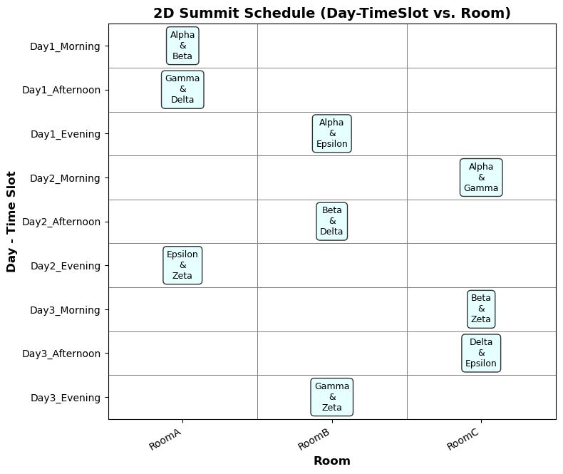
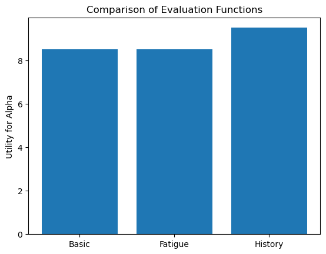
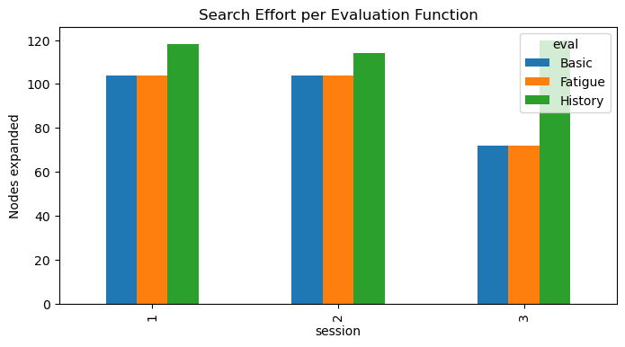
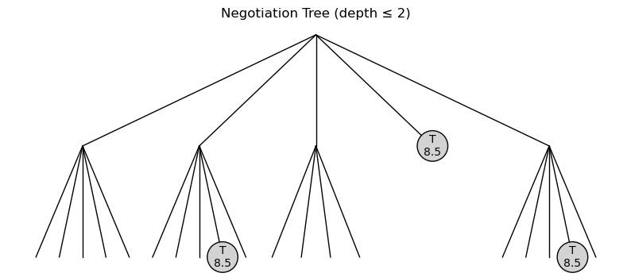

# Strategic Diplomacy AI

**Constraint satisfaction and adversarial search for a simulated diplomatic summit.**

Six rival factions meet over a 3-day summit to negotiate shared resources: Energy, Water and Technology. The project has two parts:

1. **Part A: Adaptive Diplomatic Scheduling (CSP).** A constraint solver builds the summit timetable and repairs it locally when a room goes out of service.
2. **Part B: Strategic Resource Negotiation (Adversarial Search).** Each meeting is played as a zero-sum negotiation game, solved with depth-limited Minimax and Alpha-Beta pruning under three different evaluation functions.

All search algorithms (AC-3, backtracking, forward checking, Minimax, Alpha-Beta) are implemented from scratch in plain Python and NumPy. No AI or game libraries are used.

> Programming Assignment 2 for *Artificial Intelligence* (Spring 2025) at Shiraz University, taught by Prof. Zohreh Azimifar.

<p align="center">
  
</p>

---

## Contents

```
.
├── notebooks/
│   ├── part_a_csp_scheduling.ipynb          # Part A: CSP scheduler and room-failure repair
│   └── part_b_adversarial_negotiation.ipynb # Part B: Minimax / Alpha-Beta negotiation engine
├── docs/
│   ├── report.pdf       # Full written report (39 pages)
│   └── assignment.pdf   # Original assignment handout
├── assets/              # Figures used in this README
└── requirements.txt
```

---

## Part A: Adaptive Diplomatic Scheduling (CSP)

### Problem

| | |
|---|---|
| Factions | Alpha, Beta, Gamma, Delta, Epsilon, Zeta (15 possible pairs) |
| Time | 3 days × 3 slots (Morning / Afternoon / Evening) = **9 meetings** |
| Rooms | RoomA, RoomB, RoomC. RoomB is the only **neutral** room |
| Rivals | Alpha–Delta, Beta–Epsilon, Gamma–Zeta |

### CSP formulation

- **Variables:** the 9 time slots (`Day1_Morning`, …, `Day3_Evening`)
- **Domains:** `(faction1, faction2, room)` triples. Rival pairs may only use the neutral room, so each slot has 39 candidate values.
- **Constraints:**
  - No pair of factions meets more than once
  - No faction uses the same room in two consecutive sessions
  - A faction needs at least one free slot between two sessions on the same day
  - Rival factions meet only in neutral rooms

### Techniques

- **AC-3** arc consistency as preprocessing
- **Backtracking search** with **MRV** variable ordering (domain size counts only pairs that are still unused)
- **Forward checking** after each assignment, with early failure on empty domains
- **Dynamic room failure:** when a room is destroyed, the affected meeting is first moved to another valid room in the same slot. If that fails, every other meeting stays fixed and backtracking re-solves only the affected slot, with the failed room taken out of that slot's domain. This repairs the schedule without recomputing it.

### Result

The solver finds a complete schedule almost instantly. All 6 factions get exactly 3 meetings each, and all rival meetings take place in RoomB.

| Day | Morning | Afternoon | Evening |
|---|---|---|---|
| Day 1 | Alpha & Beta (A) | Gamma & Delta (A) | Alpha & Epsilon (B) |
| Day 2 | Alpha & Gamma (C) | Beta & Delta (B) | Epsilon & Zeta (A) |
| Day 3 | Beta & Zeta (C) | Delta & Epsilon (C) | Gamma & Zeta (B) |

---

## Part B: Strategic Resource Negotiation (Adversarial Search)

### Game model

- **Players:** two factions, each with an urgency (0–10) for every resource
- **Actions:** `Offer`, `Threaten`, `Bluff`, `Concede`, `Delay` (bluffing twice in a row is not allowed)
- **Terminal states:** the depth limit is reached or a faction concedes
- **Search:** depth-limited **Minimax with Alpha-Beta pruning** (default depth 4)

### Evaluation functions

| Name | Idea |
|---|---|
| **Basic** | Static score: own urgencies minus half of the opponent's |
| **Fatigue** | Basic score minus a penalty for back-to-back sessions |
| **History** | Basic score plus a trust/rivalry term: `Offer`/`Concede` build trust, `Threaten`/`Bluff` cost it, and opponent moves count half |

### Results

Benchmark over three faction matchups (utility for the first faction, nodes expanded):

| Session | Basic | Fatigue | History |
|---|---|---|---|
| Gamma vs Delta | +9.0 / 104 | +9.0 / 104 | **+10.0** / 118 |
| Epsilon vs Zeta | +9.0 / 104 | +9.0 / 104 | **+10.0** / 114 |
| Alpha vs Beta | +7.5 / 72 | +7.5 / 72 | **+8.5** / 120 |

The history-aware evaluation scores best in every session but expands more nodes, because its values vary more and Alpha-Beta prunes less. Each search finishes in about 1 ms.

<p align="center">
  
  
</p>

<p align="center">
  
  <br><em>Negotiation game tree up to depth 2. "T" marks terminal (Concede) nodes.</em>
</p>

---

## Running it

Requires Python 3.9+.

```bash
git clone https://github.com/<your-username>/strategic-diplomacy-ai.git
cd strategic-diplomacy-ai
pip install -r requirements.txt
jupyter notebook notebooks/
```

Run the cells of each notebook from top to bottom. The two parts are independent of each other.

---

## Report

[`docs/report.pdf`](docs/report.pdf) is the full written report. It covers the CSP formulation, how room failures are handled, the design of the evaluation functions, and the analysis. It also documents the assignment's other programming question (*Conscious Drone Navigation in Adversarial Terrain*: A*, UCS and Greedy search with custom heuristics), whose code is not part of this repository.

## Authors

- **Setayesh Saeidi**
- **Fatemeh Shirvani**
